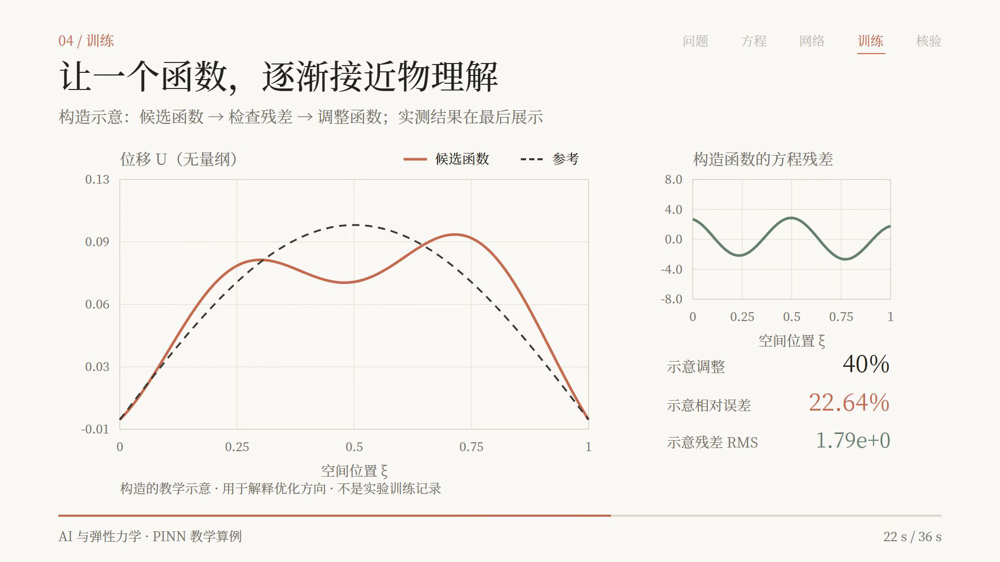

# AI × Elasticity

**从物理约束到可信计算：AI 与弹性力学问题的求解。**

这是一个面向本科讨论课的研究与教学准备项目：用可复现的一维 PINN 算例讲清神经网络如何受到方程约束，再围绕独立验证、泛化和工程适用条件组织讨论。仓库同时保存小组讨论材料、数学推导、原始文献入口、PPT 提纲和可编辑的视频动画工程。

*A teaching project on physics-informed elasticity, reproducible computation, and explanatory motion graphics.*

[下载教学视频](https://raw.githubusercontent.com/BallCard/ai-elasticity-discussion/main/motion/output/pinn-elasticity-anthropic.mp4) · [数学推导](docs/technical-notes.md) · [小组讨论包](docs/discussion-kit.md) · [PPT 提纲](slides/outline.md)



## 我们要讨论什么

1. **AI 改变了哪一步？** 从几何、材料、载荷与边界出发，对照传统求解流程，区分解函数近似、监督代理、本构学习和算子学习。
2. **凭什么相信结果？** 将方程约束、独立误差、边界满足程度、应力 / 导数误差和泛化证据分别说明。
3. **什么时候值得用？** 结合单次正问题、重复查询与反问题，讨论精度、总成本、适用条件和失败后果。

主线是 **物理问题 → 三类关系与边界 → AI 介入位置 → 一个 PINN 模型 → 独立核验 → 工程取舍**。历史作为背景，哲学问题落到具体用途与证据标准。

当前是讨论课准备稿：老师初定 **2026 年 10 月 27 日**汇报，每组 **10 分钟 + 约 3 分钟讨论**。PPT 提纲为 **18 页正文、2 页备份**，正文合计 600 秒；正式 PPTX、最终主讲人与小组定案仍待完成。

## 教学动画

当前版本使用 [vibe-motion/create-vibe-motion](https://github.com/vibe-motion/create-vibe-motion) 的 Remotion 脚手架，采用 Anthropic 风格的暖白纸色、炭黑文字、陶土色线条和 **思源宋体 CN**。

| 成品 | 说明 |
| --- | --- |
| [新版 MP4](motion/output/pinn-elasticity-anthropic.mp4) | 36 秒、1920×1080、30fps、H.264、无音轨，可直接插入 PPT |
| [预览海报](motion/output/anthropic-poster.png) | 新版训练示意段的画面 |
| [早期深蓝版](motion/output/pinn-elasticity.mp4) | 保留作对照，回放真实训练快照 |

视频分五段：**定义弹性杆问题 → 合成控制方程 → 网络与硬边界 → 调整候选函数 → 展示核验结果**。

**构造示意与实测结果明确分开。** 新版训练段用有意构造的候选函数和解析残差强化收敛过程，画面持续标注“构造示意”；末尾核验数字来自实际 PINN 训练。构造轨迹不代表优化器的实际日志，也不说明所有 PINN 都会单调收敛。详细方法见 [视觉与数据约定](motion/design.md)。

## 算例与结果

主算例是两端固定、承受正弦轴向分布荷载的均匀线弹性杆。无量纲问题为：

$$
U''(\xi)+\sin(\pi\xi)=0,\qquad U(0)=U(1)=0.
$$

PINN 使用硬边界函数 $U_\theta(\xi)=\xi(1-\xi)N_\theta(\xi)$；损失仅包含内部点的方程残差均方，**没有使用解析位移标签训练**。解析解 $U_*(\xi)=\sin(\pi\xi)/\pi^2$ 用于独立核验。

| 实际实验 | 结果 / 配置 |
| --- | --- |
| 网络与训练 | 1→16→16→1、tanh、321 个参数；64 个内部点、3000 步 Adam、随机种子 42 |
| 独立验证 | 401 个未参与优化的均匀位置 |
| 位移相对离散 L₂ 误差 | 约 **0.0021%** |
| 导数 / 应力相对离散 L₂ 误差 | 约 **0.0057%** |
| 独立残差 RMS | 约 **1.65 × 10⁻⁴** |
| 端点误差 | **0**，由硬边界构造保证 |

这些数字对应一个平滑的一维问题、一个训练种子。仓库另保留 100 单元线性杆 FEM 基准与网格加密核验；这些配置不同的结果不构成普遍的精度或速度排名。新载荷、新材料、新几何和真实工程场景仍需独立验证。

完整推导见 [技术笔记](docs/technical-notes.md)，数值与实验配置见 [demo/README.md](demo/README.md) 和 [metrics.json](demo/metrics.json)。

## 材料导航

| 入口 | 适合谁 / 做什么 |
| --- | --- |
| [背景与选题范围](docs/context.md) | 核对老师要求、组长的逻辑链和待定事项 |
| [讨论与分工包](docs/discussion-kit.md) | 组织首轮组会，分配研究任务，做头脑风暴与反方检验 |
| [数学与方法准备](docs/technical-notes.md) | 推导一维模型，比较 AI 介入方式，桥接二维弹性 |
| [文献与阅读路线](docs/reading-list.md) | 按问题读原始论文，区分论文证据和本项目推断 |
| [PPT 逐页提纲](slides/outline.md) | 依据中心问题组织 10 分钟汇报 |
| [动画工程说明](motion/README.md) | 预览、修改和重新渲染视频 |
| [动画分镜](motion/storyboard.md) | 核对每段画面应传达的内容 |
| [实际训练探索页](demo/index.html) | 下载到本地后，交互查看真实训练快照与误差 |

## 预览与渲染

已验证的动画环境：**Node.js 24.19.0、pnpm 10.33.0、Remotion 4.0.438**。锁文件、思源宋体 CN 的原始 OTF 字体和加载代码均随工程保存；渲染前会等待字体加载完成。

```sh
git clone https://github.com/BallCard/ai-elasticity-discussion.git
cd ai-elasticity-discussion/motion/render
pnpm install --frozen-lockfile --registry https://registry.npmjs.org
pnpm dev
```

在 Remotion Studio 中打开 `ElasticityPINN`。需要输出 MP4 时，在同一目录运行：

```sh
pnpm run render:video
```

输出位于 `motion/output/pinn-elasticity-anthropic.mp4`。主要修改入口是 [ElasticityScene.jsx](motion/render/motion/ElasticityScene.jsx)，配置与字体说明见 [motion/README.md](motion/README.md)。首次安装需要下载依赖和渲染浏览器，制作过程不需要模型 API 密钥。

## 复现实际训练

在仓库根目录安装依赖并运行：

```sh
python -m pip install -r demo/requirements.txt
python demo/train.py
```

脚本输出实际训练快照和验证指标；通过误差与有限性检查后才保存结果。重新渲染视频时会同步新的核验数据，构造的教学轨迹单独定义。

已有记录使用 **Python 3.13.5、PyTorch 2.9.1+cpu、NumPy 2.1.3**；具体配置和误差见 [metrics.json](demo/metrics.json)。

## 下一步与协作

先按 [讨论包](docs/discussion-kit.md) 分工：每份贡献给出问题、模型条件、关键公式或图、原始来源和一个反例。汇总后确定主算法和主案例，核对证据，再制作 PPT 和限时彩排。

当前优先事项是补齐工程适用性证据、完善最终 PPT 和讲稿，而不是同时扩展更多算法。二维内容目前是建模对应关系，尚未宣称完成二维数值复现。

## 来源与第三方材料

- 动画工程基于 [vibe-motion/create-vibe-motion](https://github.com/vibe-motion/create-vibe-motion)，上游提交与版本见 [upstream.json](motion/upstream.json)。
- 思源宋体 CN 来自本机安装的原始字体文件，文件哈希见 [font-manifest.json](motion/font-manifest.json)，许可保留在 [SIL Open Font License](motion/render/public/fonts/LICENSE.txt)。
- 力学与机器学习资料优先使用作者教材、原始论文与官方文档，具体引用与阅读程度见 [文献表](docs/reading-list.md)。
- 本仓库不包含课程教材、教师课件、原始私人对话、依赖安装目录或渲染缓存；相关准备材料的背景记录见 [context.md](docs/context.md)。
